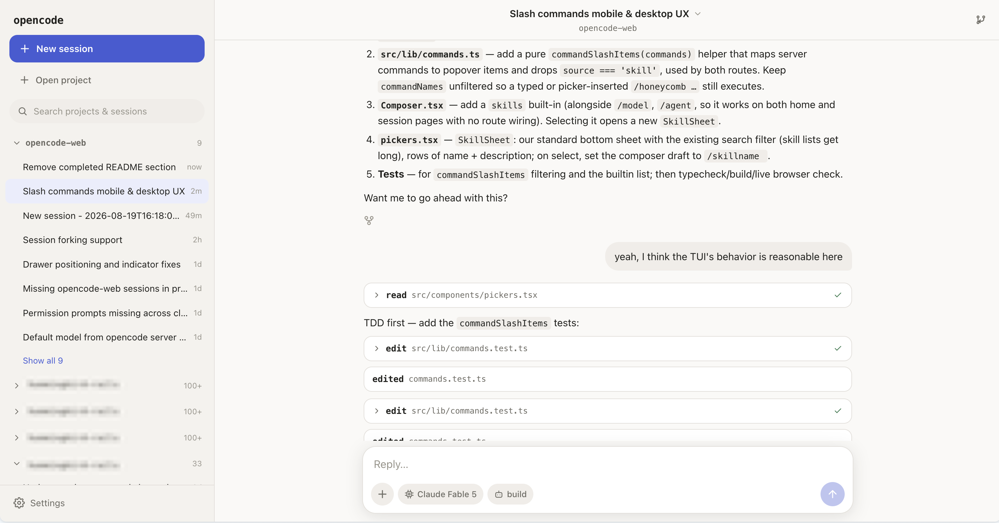
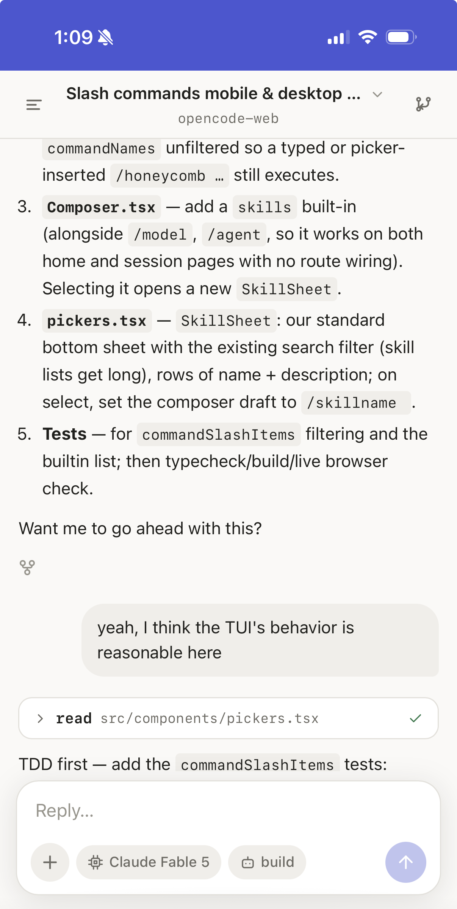

# opencode-web

A mobile-first web UI for [OpenCode](https://opencode.ai), inspired by the UX
of the Claude mobile apps. The goal is to make it pleasant to check on and
drive coding agents from a phone, while scaling up to a desktop layout with
standard responsive design.

## Interface

Use the same OpenCode projects and sessions from a persistent desktop workspace
or a focused mobile chat view.

<p align="center">
  <a href="docs/screenshots/desktop.png"></a>
  &nbsp;&nbsp;&nbsp;&nbsp;
  <a href="docs/screenshots/mobile.png"></a>
</p>

## Features

- Browse and search sessions grouped by project.
- Start and continue sessions with streaming markdown, tool calls, and diffs.
- Respond to permission requests and questions without leaving the chat.
- Attach images, PDFs, and text files to prompts.
- Switch projects, models, and agents from mobile-friendly pickers.
- Run built-in commands, server-defined commands, and OpenCode skills from the
  composer.
- Fork, compact, undo, redo, and export sessions.
- Inspect nested Code Mode calls and their progress inside `execute` tools.
- Install the responsive interface on a phone or use it in a desktop browser.

## How it works

opencode-web is an alternate client for OpenCode. It does not run coding agents
itself. OpenCode 2's local shared background service owns the projects and
sessions, runs the agents, and executes their tools.

The web app has its own server process, which proxies requests from the browser
to that service using `@opencode/client`. It discovers the service through its
local registration file and keeps service credentials on the server. If the
service is stopped, it runs `opencode service start`, which applies your
`service.json` configuration, then discovers it again. The browser needs only
the opencode-web address. Both server processes run on the same computer.

OpenCode remains the source of truth. Sessions created in this app are visible
in other OpenCode clients, and changes made elsewhere stream back into the web
interface. The app projects V2 streaming events into the same message shapes
returned by the history API. After an event connection drops, it reconnects
and reloads cached data to recover missed events.

## Running it

You need [Bun](https://bun.sh) and the
[OpenCode 2 CLI](https://opencode.ai/v2/docs/). Make sure `opencode` on the
web server's PATH is version 2.0.29 or later. Install dependencies and start
opencode-web:

```sh
bun install
bun run dev
```

Open `http://localhost:3000` and use **Open project** to choose a directory.
The shared service starts automatically if needed. Configure OpenCode through
its own configuration files; there is no server URL or password to enter in
opencode-web.

### Phone access

Bind the development server to your network interface:

```sh
bun run dev -- --host 0.0.0.0
```

Open `http://<your-computer-ip>:3000` from a phone on the same network.
The OpenCode service can stay bound to loopback: the opencode-web server
connects to it on your phone's behalf.

OpenCode's `opencode pair` and `opencode pair --remote` connect devices to
OpenCode's own interface. Their pairing links and service tunnel do not expose
this separate web app. To reach opencode-web remotely, expose its web port
through your VPN or authenticated HTTPS reverse proxy.

To install the interface, use **Add to Home Screen** from Safari's share menu
on iOS. On Android, use your browser's **Install app** or **Add to Home screen**
menu item.

**Important:** binding to `0.0.0.0` will allow any device on your local network
to access your OpenCode server via opencode-web's proxy route. It's highly
recommended to instead use [Tailscale](https://tailscale.com). Put the device
running opencode-web and your mobile device into the same Tailnet, then instead
bind opencode-web's server to the private Tailnet IP:

```sh
bun run dev -- --host "$(tailscale ip -4)"
```

The opencode-web client will then be available on your mobile device at
`http://<tailscale-ip>:3000`.

### Production

Build and run the production server with:

```sh
bun run build
bun run start
```

### Development

Run the automated checks with:

```sh
bun run test
bun run typecheck
bun run build
```

## Security caveat

The proxy route is intentionally unauthenticated. Anyone who can reach
opencode-web can drive your local OpenCode service, which executes commands
on your machine. Service discovery fixes the upstream destination; browsers
cannot choose an arbitrary server URL.

This is intended for personal use on a trusted machine and network. Do not
expose it directly to the public internet. Use an encrypted VPN such as
Tailscale, or an HTTPS reverse proxy that authenticates every request, for
remote access.

## Using OpenCode 1.x

The `v1` git tag is the last V1-compatible version:

```sh
git clone --branch v1 https://github.com/jdormit/opencode-web.git
cd opencode-web
bun install
bun run dev
```

Follow that version's README for its `opencode serve` setup. V2 has no session
sharing endpoint, so share and unshare are unavailable in the current app.

## License

[MIT](LICENSE)
